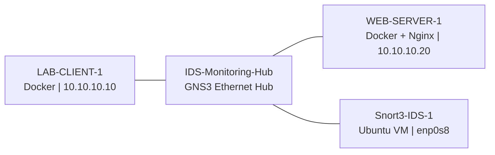

<div align="center">

# 🛡️ GNS3 + Snort 3 | Live IDS Detection Lab

### 🔍 From Packet Captures to Real-Time Threat Detection

**A hands-on blue-team cybersecurity project featuring virtual networking, custom Snort 3 signatures, traffic analysis, and evidence-based validation.**


**[🏗️ Architecture](#️-lab-architecture) · [🧪 Test Results](#-test-004--verified-results) · [📸 Screenshots](#-screenshots--visual-evidence) · [🗂️ Full Timeline](docs/SCREENSHOT_TIMELINE.md)**

</div>

---

**🎯 Mission:** Deploy a passive intrusion detection system in an isolated GNS3 lab, develop custom ICMP signatures, and validate alerts against both offline PCAPs and live network traffic.

> **Scope:** This project demonstrates ICMP request and rate detection in a controlled virtual environment. It does **not** demonstrate successful denial of service, production-grade rule tuning, or attack attribution.

## 📊 TEST-004 — Verified Results

| Measurement | Verified result |
|---|---:|
| ICMP requests sent | 30 |
| ICMP replies received | 30 |
| Packet loss | 0% |
| LAB-001: ICMP echo request alerts (SID 1000001) | **30** |
| LAB-002: Elevated ICMP request-rate alerts (SID 1000002, rev 2) | **25** |
| Total logged alert records | **55** |

**✅ Outcome:** Both signatures successfully triggered during the controlled live test. Counts were verified from the LAB-CLIENT console and Snort's `alert_fast.txt`.

> 🧠 **Interpreting the results:** 55 logged alerts are **not** 55 attacks. The experiment validated detection of ICMP traffic and elevated request rates; it did not demonstrate a successful denial of service.

## 🏗️ Lab Architecture



- **Host:** Windows 11, GNS3 2.2.61, Oracle VirtualBox
- **Network:** Docker client and Nginx web server hosted on the GNS3 VM
- **Sensor:** Ubuntu Server 26.04.1 LTS with Snort 3.12.4.0
- **Detection:** Custom Snort signatures in [`rules/local.rules`](rules/local.rules)
- **Tooling:** tcpdump, Wireshark, editcap, capinfos, SSH

The sensor's second interface `enp0s8` was configured as a **passive monitoring NIC**, without an IPv4 address. The separate NAT interface supported Ubuntu management and SSH.

## 🧰 What I Built & Tested

### 🖧 Phase 1 — Virtual Network & Connectivity

1. Deployed two Docker nodes in GNS3.
2. Assigned `10.10.10.10/24` to the client and `10.10.10.20/24` to the Nginx server.
3. Verified ICMP connectivity and HTTP service response.

### 🛡️ Phase 2 — Snort 3 Sensor Integration

1. Installed and validated Snort 3 on an Ubuntu VirtualBox VM.
2. Added a second network interface for monitoring and connected it to the shared GNS3 hub.
3. Enabled promiscuous capture in Ubuntu.
4. Confirmed `tcpdump` saw **live ICMP requests, replies, and ARP traffic**.

### 🧪 Phase 3 — Offline Rule Development

1. Captured a controlled ICMP burst and converted the capture for Snort PCAP replay.
2. Created `LAB-001` to detect individual ICMP echo requests.
3. Tuned `LAB-002` to detect elevated request rates using `detection_filter:track by_dst,count 5,seconds 2`.
4. Validated both signatures with Snort's configuration test and packet-capture analysis.

### 🚨 Phase 4 — Live Detection & Evidence

Generated **30 ICMP requests at 100 ms intervals** inside the isolated lab:

```bash
ping -c 30 -i 0.1 10.10.10.20
```

Ran Snort in live mode against the sensor NIC with file-based alerts:

```bash
sudo /usr/local/snort3/bin/snort \
  -c /usr/local/snort3/etc/snort/snort.lua \
  -R /usr/local/snort3/etc/snort/rules/local.rules \
  -i enp0s8 -A alert_fast \
  --lua 'alert_fast = { file = true }' \
  -l /home/snortadmin/DoS-Detection-Lab/evidence/TEST-004 -q
```

Verified alert counts using:

```bash
sudo grep -c '1000001' ~/DoS-Detection-Lab/evidence/TEST-004/alert_fast.txt
sudo grep -c '1000002' ~/DoS-Detection-Lab/evidence/TEST-004/alert_fast.txt
# Recorded results: 30 and 25
```

See [TEST-004 results and limitations](docs/TEST-004-results.md).

## 💡 Key Lessons

- Installing an IDS is not enough; the sensor must be **positioned to see the intended traffic**.
- Simultaneous packet capture and traffic generation helped distinguish idle interfaces from link problems.
- Rate-based detection requires rule tuning and independent validation.
- An alert indicates a signature match, not a proven denial-of-service impact.
- Evidence should include both the packet-level observations and reproducible alert counts.

## 📂 Evidence & Reproducibility

**All 151 reviewed screenshots are now present in the repository**, organized into four date-based folders. The two originally password-exposing images were checked against the redacted publication archive by Git blob hash during the prior audit.

The original `TEST-004/alert_fast.txt` and PCAP data have **not** been uploaded. See [evidence notes](evidence/README.md).

### 📸 Screenshots — Visual Evidence

**🕸️ Network topology:** Client, web server, monitoring hub, and passive Snort sensor

.png)

**📡 Packet visibility:** tcpdump confirms client-to-server traffic reaches the sensor

.png)

**🚨 Live IDS:** Custom ICMP and elevated-rate detection alerts

.png)

**✅ TEST-004 validation:** 30 basic alerts + 25 elevated-rate alerts

.png)

### 🗂️ Screenshot-by-Screenshot Timeline

The complete [**151-image annotated lab timeline**](docs/SCREENSHOT_TIMELINE.md) describes each original capture, its diagnostic purpose, and its role in troubleshooting. The [**screenshot index (CSV)**](docs/SCREENSHOT_INDEX.csv) records expected paths, descriptions, audit status, and SHA-256 values of the publication-reviewed images.

**Screenshot upload complete:** All 151 filenames in the published screenshot index are represented in `screenshots/`, including entries **005–014** from October 15.

## ⚠️ Scope & Limitations

- One client, one server, and a bounded ICMP test; no actual service degradation was established.
- The sensor was passive and **did not block network traffic**.
- A 5-request/2-second threshold is an educational lab setting, **not a production baseline**.
- TCP SYN and HTTP flood scenarios were planned but **not executed** as part of this completed project.
- GNS3 portable export rejected the VirtualBox-integrated project; separate project and VM backups are required.

## 📚 Documentation & References

- [Snort 3 documentation](https://docs.snort.org/)
- [GNS3 documentation](https://docs.gns3.com/)
- [Oracle VirtualBox manual](https://www.virtualbox.org/manual/)

---

> 🔐 **Responsible testing:** All traffic described was generated inside an isolated, user-controlled virtual lab.

<div align="center">

**Built to learn. Tested to verify. Documented to share. 🛡️**

</div>
